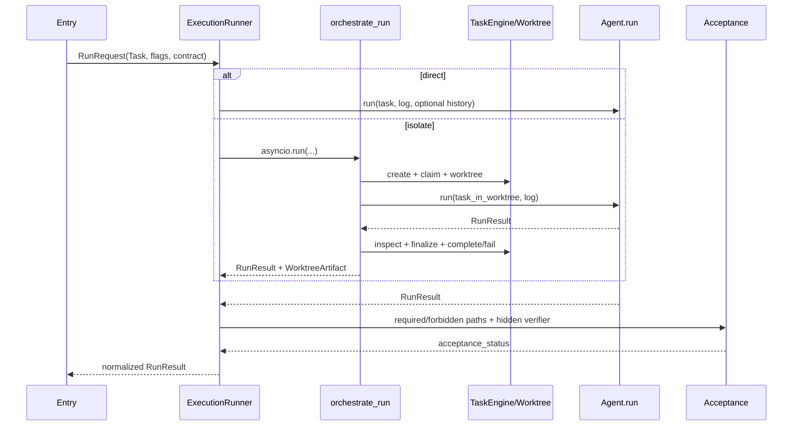

# 01 执行入口与任务生命周期

> 基线：`dev@fd700bdf48ace5f03bb9feab49d72f7c12e5ddcb`，2026-11-12

## 1. 功能目标

这一层把 CLI、Chat、HTTP API 和 GitHub Issue 的输入转换为同一种 `RunRequest`，统一创建
Agent、Trace、Acceptance 与资源生命周期。它解决的是“入口不同但执行合同不能分叉”的问题。

## 2. 职责与边界

`ExecutionRunner` 是产品执行组合根；`orchestrate_run()` 只是 isolate 分支的异步组合根。
Runner 不负责 ReAct 决策，Orchestrator 不负责独立验收，入口不应直接调用 Tool。

| 入口 | 调用方 | 运行形态 | 特有状态 |
|---|---|---|---|
| CLI | `entry.cli.run` | direct 或 isolate；direct 可 sandbox | 终端 renderer、可选确认 |
| Chat | `ChatSession.run_round` | direct，共享 History | Session state、每轮 Trace、Compaction |
| API | `run_agent_task` | 默认 isolate | ApiTaskStore、线程池、cancel event、SSE |
| GitHub Issue | `run_on_issue` | 克隆目录上的 direct | Issue 元数据、Acceptance、确定性交付 |

## 3. 调用图

## 4. 关键执行流程

1. 入口加载配置，创建 backend、registry、`AgentConfig`、`Task`。
2. Runner 用 `AcceptanceContract.apply()` 将 change/test 要求冻结到 Task，并解析 entrypoint。
3. direct：Runner 创建/复用 Agent，创建 EventLog，执行 shared-history 首轮 preflight，再调用
   `Agent.run()`。
4. isolate：拒绝 shared History，要求 `registry_builder`，调用 Orchestrator；后者创建
   TaskEngine 记录、Worktree、Runtime、workspace-bound Permission/Executor，再运行新 Agent。
5. Runner 统一执行 independent acceptance，追加 acceptance 和 `run_terminated` Trace。
6. GitHub 入口在此之后才可能 commit、push、create PR；Acceptance 失败先阻断交付。

异常分支：sandbox preflight 在 Agent 前失败，Runner 将其归一为
`FAILED/infrastructure_error`；direct 未处理异常写 `run_exception` 后继续抛出；isolate 的
Worktree finalization 失败不会静默吞掉原异常。

## 5. 核心数据结构

- `agent.task.Task`：Agent 领域任务；包含 description、repo_path、max_steps、change/test 要求。
- `agent.runner.RunRequest`：入口到 Runner 的组合参数，含 isolate/sandbox/history/cancel/
  constraints/acceptance。它不是持久化任务。
- `task.engine.Task`：SQLite 任务记录；与 `agent.task.Task` 同名但属于 isolate 调度状态域。
- `RunResult`：Agent 状态、termination、usage、patch、Trace、Worktree、Acceptance 的交付对象。
- `AcceptanceContract`：Runner 私有的 required/forbidden paths 与 verifier，不写入 History。
- `WorktreeArtifact`：最终 disposition、path、branch、changed files、partial 标记。

## 6. 源码对应关系

| 符号 | 职责 | 调用关系 |
|---|---|---|
| `entry.cli.run` | direct/isolate CLI composition | → Runner |
| `ChatSession.run_round` | 新建每轮 Task、checkpoint、共享 History | → Runner direct |
| `entry.api.run_agent_task` | 后台线程、取消和 API 状态归一 | → Runner isolate |
| `entry.github_issue.run_on_issue` | clone/branch/issue task | → Runner direct → delivery |
| `ExecutionRunner.run` | direct/isolate 分叉、Trace、Acceptance | → Agent 或 Orchestrator |
| `orchestrate_run` | TaskEngine/Worktree/Runtime 生命周期 | → Agent.run |
| `_apply_independent_acceptance` | Agent 后置独立验收 | ← RunResult |

## 7. 关键实现细节

- direct MCP manager 归 Runner 所有，可跨 Chat/direct run 复用；isolate MCP manager 每 run 创建并关闭。
- `_prepare_shared_history_boundary` 只在已有共享 History 且配置 callback 时执行，并复用
  `Agent._prepare_next_turn` 的取消/失败语义。
- API 的 `ApiTaskStore` 管 HTTP 队列状态；isolate 内的 `TaskEngine` 管 Agent Worktree 任务，
  两者不是同一张表。
- entrypoint 可显式设置；兼容推断依次看 issue_url、cancel_event、history/session。

## 8. 设计取舍

同步 Agent 保持可测，异步生命周期集中在 Orchestrator；代价是 Runner 用 `asyncio.run()` 桥接，
且不能在已有 event loop 中直接复用。Acceptance 与 Agent 分离防止模型控制隐藏验收，但 verifier
失败不会自动进入下一轮修复。以上是源码事实；“为何不做统一全异步”只在历史文档中被描述为
降低重写成本，不应扩写成性能结论。

## 9. 测试与验证

- Runner/Acceptance：`tests/test_runner.py`。
- direct/isolate 与接线：`tests/test_cli_isolate.py`、`tests/test_orchestrate.py`。
- Chat/API/Issue：`tests/test_chat.py`、`tests/test_api.py`、
  `tests/test_github_issue_delivery.py`。
- TaskEngine/Worktree：`tests/test_task_engine*.py`、`tests/test_worktree_session.py`。
- 故障注入：`tests/test_failure_harness*.py`。这些证明合同回归，不是线上 SLA。

## 10. 面试理解重点

**为什么 Runner 和 Orchestrator 都存在？** Runner 统一产品合同和 Acceptance；Orchestrator 只处理
isolate 的异步 Worktree/Runtime 生命周期。
**为什么 API 有两套任务状态？** ApiTaskStore 服务 HTTP 排队/取消，TaskEngine 服务隔离执行；
它们的 owner 和生命周期不同。
**为什么 hidden verifier 不交给 Agent？** 防止模型针对验收实现投机，并保留 Agent SUCCESS 与
Acceptance failed 的两层事实。
