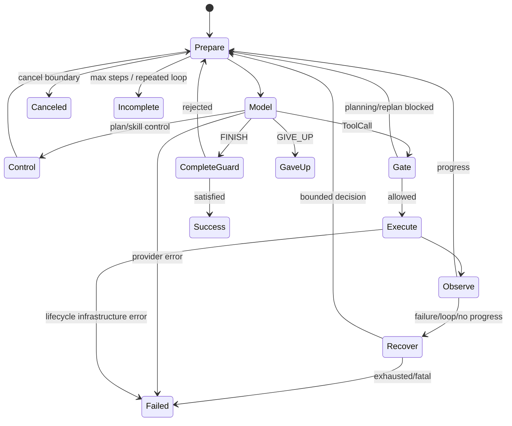

# 02 Agent 主循环与 Tool 生命周期

> 运行期修复基线：`dev`，2026-11-13；对应实施记录见 `docs/changes/2026-11-13/Forge-Agent-运行期问题修复规划与实施记录.md`。

## 1. 功能目标

同步 ReAct 主循环把模型动作转成受治理的工具副作用，并用 Observation、Trace、完成性和恢复状态
推进下一轮。中央 Tool lifecycle 保证四入口不会各自实现权限、Hook、取消和错误分类。

## 2. 职责与边界

`Agent.run()` 拥有 step、History、运行时状态、Completion Guard 和终止结果；LLM backend 只负责
协议；`ToolExecutor` 只负责一次 ToolCall 生命周期；具体 Tool 只执行动作。Planning/Skill control
是 Agent 内部控制面，不经过 ToolExecutor；MCP remote tool 是数据面 Tool，必须经过 ToolExecutor。

## 3. 状态图



## 4. 关键执行流程

每 step：可选 `_prepare_next_turn` → `_build_messages` → backend retry → Action normalization/Trace。
control action 更新 runtime context；普通 ToolCall 先经过 plan/replan gate，再执行：

```text
cancel → validate → pre-hook → cancel → permission/constraint
       → cancel → invocation trace → tool → post-hook → ToolResult
       → Observation/repository effect/Trace → cancel
```

Tool 后比较 Git-aware repository state 与 checkout-visible content fingerprint。已知 file path 可增量
更新 Repo Map；shell/git 等未知变更请求下一轮 sync。测试结果和 MCP 新 evidence 都可算 semantic
progress；普通 read 或重复 evidence 不会无限刷新进度。

FINISH 依次检查：未解决 fatal infrastructure、required change、是否测试、最新测试是否通过、
成功测试后内容是否又变化。失败写 `completion_rejected` 并允许恢复；通过才返回 SUCCESS。

## 5. 核心数据结构

- `Action/ActionType/ToolCall`：模型解析后的动作；终态为 FINISH/GIVE_UP。
- `Observation`：status、output、error、error_type；普通工具失败是可恢复事实。
- `ToolResult`：Tool 层结果；`to_observation()` 映射到 Agent。
- `ToolEffect`：READ_ONLY/MAY_MUTATE，服务 Planning 和 Permission 的保守判断。
- `Event/EventType`：Action、Observation、Tool span、repository effect、termination 等 Trace 事件。
- `LoopDetector`：动作/观察/仓库/测试指纹的有界周期检测。
- `SemanticProgressTracker`：对 Skill/Plan/Test/MCP evidence 去重。

## 6. 源码对应关系

| 符号 | 职责 |
|---|---|
| `Agent.run` | 唯一同步主循环 |
| `Agent._call_with_retry` | Provider retry、backoff、cancel wait |
| `Agent._apply_no_progress_guard` | control/tool 共用 no-progress 处理 |
| `LoopDetector.observe` | 周期识别与 reflect/terminate 分级 |
| `ToolRegistry.validate_tool_call` | unknown/schema validation |
| `harness.ToolExecutor.execute` | 安全默认 lifecycle |
| `PermissionManager.check` | shell/path/MCP policy |
| `EventLog.log_trace` | Trace v2 写入与观察者通知 |

## 7. 关键实现细节

- package-level `harness.ToolExecutor` 默认注入 `PermissionManager`；测试可显式导入 raw executor。
- pre-hook block/exception 都不进入 permission/tool；post-hook 已在副作用后，只追加 diagnostic。
- permission/confirm callback crash 是 infrastructure error，deny/reject 是可恢复 Observation。
- Tool 已开始后收到 cancel 不强杀：保留 ToolResult、post-hook、Observation，再在 Agent 安全边界取消。
- GitTool 与 PytestTool 通过 `Runtime.exec_args(argv)` 执行结构化参数；LocalRuntime 使用
  `subprocess.run(..., shell=False)`，DockerRuntime 使用 `docker exec ... COMMAND ARG...`，
  不对这些参数再做 Shell 解析。ShellTool 仍是显式 shell 能力，继续由 PermissionManager 管理。
- CONFIRM 在没有交互审批 callback 时 fail closed，并返回“没有审批通道、操作未执行、不要重试”
  的明确 Observation，避免模型把权限拒绝误判成工具执行失败。
- `TOOL_INVOCATION_STARTED` 与 `REPOSITORY_EFFECT` 区分“尝试”“实际调用”“实际仓库变化”，
  供 abstention V2 评分。
- 本次 EventLog path 被 Completion Guard 内容指纹精确排除；不会忽略整个日志目录。

## 8. 设计取舍

将 validation/permission/hook 放在 Tool 外层避免每个 Tool 重复治理；保守 effect 会带来更多确认，
但不会因未知能力误放行。Completion Guard 只检查通用 change/test 条件，复杂业务正确性留给
Independent Acceptance。Trace 是 append-only 审计而非 replay，换来实现简单和真实副作用不被伪造。

## 9. 测试与验证

`tests/test_tool_lifecycle_p0_2.py` 固定顺序和故障语义；`tests/test_runtime_context_fixes.py`
覆盖 argv、解释器选择和无交互 CONFIRM；`tests/test_failure_harness.py` 覆盖
provider/hook/permission/tool/cancel/termination；`tests/test_agent_completion_guards.py`、
`tests/test_repository_state.py` 覆盖最终状态；`tests/test_loop_detector.py`、
`tests/test_trace_v2.py`、`tests/test_execution_constraints.py` 覆盖循环、Trace、只读约束。

## 10. 面试理解重点

**为什么普通 Tool failure 不直接 FAILED？** 它被转成 Observation，模型或 Recovery 仍可改方法；
只有执行框架/权限子系统不可信时才终止。
**为什么 post-hook 失败不能覆盖结果？** Tool 副作用已经发生，覆盖会丢失真实世界事实并诱发重试。
**Completion Guard 与 Acceptance 有何区别？** 前者在 Agent loop 内提供可恢复反馈；后者在 Runner
外执行隐藏、独立的最终判定。
