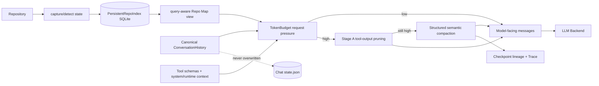

# 03 Context Engineering、Repo Map 与 Session

> 原架构核查基线：`dev@fd700bdf48ace5f03bb9feab49d72f7c12e5ddcb`，2026-11-12；运行期修复见 `docs/changes/2026-11-13/Forge-Agent-运行期问题修复规划与实施记录.md`；后续加固增量见 [Harness 加固合同](Harness加固合同.md)。

## 1. 功能目标

> 2026-11-16 增量：产品 `incremental` 模式的初始摘要上限为 `context.repo_map_summary_budget`（默认 2000 个本地 Counter Token），读到目标文件后减半并把路径加入排序 query；`repo_map_budget` 继续作为总硬上限。`none/static/query_aware` 仍用于消融。`Agent.repo_map_telemetry` 增加缓存命中计数。`find_symbol`、`search_text`、`file_view` 已提供定义、引用文本和文件的按需查询；没有因 Aider 参考直接替换当前排序为 PageRank，也没有声称真实模型检索质量已改善。

Context 层在模型窗口内保留任务约束、最近证据和相关仓库结构，同时把 canonical History、模型视图、
持久化 Session 和审计 Trace 分开，避免压缩或恢复时破坏事实源。

## 2. 职责与边界

`ConversationHistory` 只存完整逻辑消息；`TokenBudget` 规划请求；Repo Map 提供结构导航；
`TraceableCompaction` 生成一次性 model-facing override；`JsonChatSessionStore` 才是 Chat 恢复
真相源。Provider usage 是请求后事实，本地 TokenCounter 只是请求前估算。`history_window`
目前仅为兼容字段，不执行 canonical History 的消息数量裁剪。

## 3. 数据流

## 4. 关键执行流程

Repo Map 由 `ContextConfig.repo_map_mode` 控制，默认 `incremental`。支持 `none`、`static`、
`query_aware`、`incremental`。其实际构建预算为
`min(available_input_tokens * 0.15, ContextConfig.repo_map_budget)`；默认上限仍为 12000。
生产 Agent 以 `TokenBudget.counter` 传入 `RepoMap.build(counter=...)`，按完整渲染结果（含换行和省略提示）
逐块检查上限；严格性相对于同一本地 Counter，不代表 Provider 精确分词或账单。直接调用 build 且未传
counter 的历史研究入口保留 `budget * 4` 字符近似模式。
`PersistentRepoMap.sync()` 读取 index 和之前的 `RepositoryState`，捕获当前状态并检测变更；
不可靠时 full rebuild，可靠 changed paths 只重新解析目标文件；query 改变只在
`RepoMap.build(query=...)` 重排。

`Agent._build_messages` 组合稳定 system/tool schema、Planning/Recovery/Skill runtime context、
Repo Map 与 History。Repo Map 已嵌入 system prompt，因此 `request_pressure` 的 system_tokens
已经包含它；独立 repo_map_tokens 只用于诊断，不重复累加。

CLI run、CLI chat、API、GitHub Issue 和 Eval 通过 `entry/context_common.py::build_context_policy`
创建各自独立的 `TraceableCompaction`。每次后续模型调用前先计算完整请求压力，Stage A 剪枝旧工具输出；
仍超阈值才建立 deterministic evidence 和 semantic packet，调用 summarizer；失败用 structured
fallback。结果通过 `PrepareNextTurnResult.history_override` 仅影响下一模型视图，不覆盖 canonical
History。Chat 的已有 shared history 仍在新 round 首次模型调用前执行 preflight。

Chat 每轮开始前写 `pending_round` checkpoint，完成/中断后原子更新 `state.json`；每轮 JSONL
只负责审计。仓库 revision 改变会让 Repo Map cache 失效。

## 5. 核心数据结构

- `TokenBudget/ContextPressure/BudgetPlan`：可用输入、分区和压力。
- `ModelCapabilities`：context window、output reserve、Forge cap；未知 proxy 不伪造能力。
- `FileInfo/Symbol`：Repo Map 解析结果；symbol 可来自 tree-sitter、Python AST 或 regex fallback。
- `PersistentRepoIndex`：版本化 SQLite metadata/files/symbols/import tokens。
- `RepositoryState/RepositoryChanges`：Git 与 filesystem fallback 的变化检测。
- `CompactionCheckpoint/ActiveCompactedView`：source refs、hash、lineage、before/after token。
- `ChatSessionState`：History、usage、rounds、pending、repo revision、checkpoint、revision。

## 6. 源码对应关系

| 符号 | 职责 |
|---|---|
| `ConversationHistory.add/to_list` | canonical history，不按旧 window 破坏性删除 |
| `TokenBudget.request_pressure` | 计算完整请求压力 |
| `RepoMap._scan/build` | 文件发现、符号/引用、query-aware 渲染 |
| `PersistentRepoMap.sync/update_paths` | warm load、变更检测、增量更新 |
| `PersistentRepoIndex.apply_changes` | SQLite 原子索引更新 |
| `TraceableCompaction.__call__` | 两阶段压缩与 model view override |
| `build_deterministic_evidence` | working set、约束、事件证据 |
| `JsonChatSessionStore.save` | lock + revision + temp/fsync/replace |

## 7. 关键实现细节

- 默认 index path 基于仓库 identity，允许跨进程 warm reuse；schema/version 异常会 reset/fallback。
- 文件工具成功且 path 已知时调用 `update_paths`；shell/git 或不确定变更请求下一轮 `sync`。
- query relevance 综合 path、symbol 和 source terms；结构索引与 query view 分离。
- Stage A 保护 recent history units；semantic packet 优先最近用户证据，选中后恢复时间顺序。
- compaction side-call usage 由 ExecutionRunner 在正常返回路径合并进 RunResult；Chat 中断路径由
  ChatSession 消费未归集 usage。Semantic side-call 失败记录 Trace，不删除 canonical History。
- Chat 使用 `/model` 切换 Backend 时，`TraceableCompaction.bind_backend` 同步更新 semantic summarizer；
  canonical History 和已保存 Session 继续保留，下一轮使用新模型预算。
- Trace Token Breakdown 与 TokenBudget 复用同一个 Counter；Provider Usage 仍是请求后统计真值。
- `configured_agent_options` 统一上述入口的请求预算、Repo Map、测试解释器和可选累计预算；Eval
  不再把携带模型元数据的 `ContextBudgetSpec` 强转为 int。Suite 显式覆盖预算时保留 Counter/输出预留信息。
- `agent.max_model_calls` 与 `agent.max_total_tokens` 是默认关闭的 Trial 累计限额，与单请求窗口不同；
  前者限制逻辑模型请求，后者依据返回 usage 判断是否继续，未知 usage 不能记成零。它们不能预先保证
  下一次请求的精确费用，也不提供进程级强制取消。
- Session save 对 secret pattern 递归 redaction，以 revision + 文件锁拒绝 stale writer。

## 8. 设计取舍

持久化结构索引降低 warm/incremental 成本，但 cold build 可能比 legacy 更慢；这是现有 benchmark
明确观察，不应宣称所有场景加速。保留 canonical History 增加磁盘/内存占用，但让压缩可追溯且
Session 可恢复。Compaction 现在由统一工厂接入 CLI run/chat、API 和 GitHub Issue；每个 run/session
使用独立 Policy，避免 checkpoint lineage、active view 和 side-call usage 在任务间共享。

## 9. 测试与验证

Repo Map：`tests/test_repo_map_improvements.py`、`tests/test_repo_map_persistent*.py`、
`tests/test_repo_map_product_behavior.py`、`tests/test_repo_map_reference_semantics.py`。Context：
`tests/test_model_aware_token_budget.py`、`tests/test_tool_pruning.py`、`tests/test_structured_compaction.py`、
`tests/test_prepare_next_turn.py`、`tests/test_runtime_context_fixes.py`。Session：
`tests/test_session_store.py`、`tests/test_chat.py`。

审计修复新增 `tests/test_audit_repo_map_budget.py`（同 Counter 上限、目标符号、修改/删除新鲜度）与
`tests/test_audit_config_parity.py`（入口配置、预算元数据、每 Trial 独立 Policy、累计限额校验）。这些是
离线合同验证，不是实际模型 Token 消耗下降或成功率提升的证据。

冻结证据只证明对应协议：12-case query-aware MRR/recall、persistent strict equivalence 和 phase timing；
reference-count 71.26× 是子步骤，不是 Agent E2E。

## 10. 面试理解重点

Project Memory 的已核查增量见 [10-Project-Memory-架构](10-Project-Memory-架构.md)。`MemoryRuntime.context` 在首次模型请求前以当前 `TokenBudget.counter` 选取历史项目知识，作为标注为低可信数据的 runtime context 进入 system prompt 和同一请求压力计算；canonical History、Chat Session JSON、RepoMap SQLite 均不承载记忆。Chat 恢复在 Runner 预处理前也准备这段上下文。

**为什么 compaction 不覆盖 History？** History 是事实源和恢复基础，压缩只应改变本次模型视图。
**增量 Repo Map 如何决定更新？** 比较持久化 RepositoryState 与当前状态；可靠 changed paths 局部
重解析，不可靠原因 full rebuild。
**Trace 为什么不能恢复 Chat？** Trace 是事件审计；Session 还需要 canonical History、round/pending、
usage、revision 和 checkpoint lineage。
