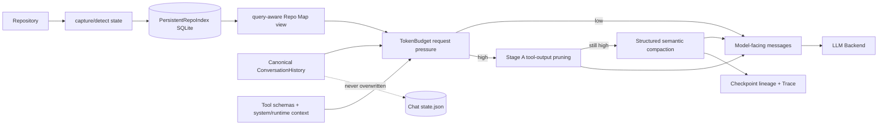

# 03 Context Engineering、Repo Map 与 Session

> 基线：`dev@fd700bdf48ace5f03bb9feab49d72f7c12e5ddcb`，2026-11-12

## 1. 功能目标

Context 层在模型窗口内保留任务约束、最近证据和相关仓库结构，同时把 canonical History、模型视图、
持久化 Session 和审计 Trace 分开，避免压缩或恢复时破坏事实源。

## 2. 职责与边界

`ConversationHistory` 只存完整逻辑消息；`TokenBudget` 规划请求；Repo Map 提供结构导航；
`TraceableCompaction` 生成一次性 model-facing override；`JsonChatSessionStore` 才是 Chat 恢复
真相源。Provider usage 是请求后事实，本地 TokenCounter 只是请求前估算。

## 3. 数据流

## 4. 关键执行流程

Repo Map 默认 `incremental`：`PersistentRepoMap.sync()` 读取 index 和之前的
`RepositoryState`，捕获当前状态并检测变更；不可靠时 full rebuild，可靠 changed paths 只重新
解析目标文件；query 改变只在 `RepoMap.build(query=...)` 重排。

`Agent._build_messages` 组合稳定 system/tool schema、Planning/Recovery/Skill runtime context、
Repo Map 与 History。Chat 在已有历史的下一轮/step 调 `TraceableCompaction`：先计算完整请求压力，
Stage A 剪枝旧工具输出；仍超阈值才建立 deterministic evidence 和 semantic packet，调用 summarizer；
失败用 structured fallback。结果通过 `PrepareNextTurnResult.history_override` 仅影响下一模型视图。

Chat 每轮开始前写 `pending_round` checkpoint，完成/中断后原子更新 `state.json`；每轮 JSONL
只负责审计。仓库 revision 改变会让 Repo Map cache 失效。

## 5. 核心数据结构

- `TokenBudget/ContextPressure/BudgetPlan`：可用输入、分区和压力。
- `ModelCapabilities`：context window、output reserve、Forge cap；未知 proxy 不伪造能力。
- `FileInfo/Symbol`：Repo Map 解析结果；symbol 可来自 tree-sitter、Python AST 或 regex fallback。
- `PersistentRepoIndex`：版本化 SQLite metadata/files/symbols/import tokens。
- `RepositoryState/RepositoryChanges`：Git 与 filesystem fallback 的变化检测。
- `CompactionCheckpoint/ActiveCompactedView`：source refs、hash、lineage、before/after token。
- `ChatSessionState`：History、usage、rounds、pending、repo revision、checkpoint、revision。

## 6. 源码对应关系

| 符号 | 职责 |
|---|---|
| `ConversationHistory.add/to_list` | canonical history，不按旧 window 破坏性删除 |
| `TokenBudget.request_pressure` | 计算完整请求压力 |
| `RepoMap._scan/build` | 文件发现、符号/引用、query-aware 渲染 |
| `PersistentRepoMap.sync/update_paths` | warm load、变更检测、增量更新 |
| `PersistentRepoIndex.apply_changes` | SQLite 原子索引更新 |
| `TraceableCompaction.__call__` | 两阶段压缩与 model view override |
| `build_deterministic_evidence` | working set、约束、事件证据 |
| `JsonChatSessionStore.save` | lock + revision + temp/fsync/replace |

## 7. 关键实现细节

- 默认 index path 基于仓库 identity，允许跨进程 warm reuse；schema/version 异常会 reset/fallback。
- 文件工具成功且 path 已知时调用 `update_paths`；shell/git 或不确定变更请求下一轮 `sync`。
- query relevance 综合 path、symbol 和 source terms；结构索引与 query view 分离。
- Stage A 保护 recent history units；semantic packet 优先最近用户证据，选中后恢复时间顺序。
- compaction side-call usage 单独累计后合并 RunResult；其失败记录 Trace，不删除 canonical History。
- Session save 对 secret pattern 递归 redaction，以 revision + 文件锁拒绝 stale writer。

## 8. 设计取舍

持久化结构索引降低 warm/incremental 成本，但 cold build 可能比 legacy 更慢；这是现有 benchmark
明确观察，不应宣称所有场景加速。保留 canonical History 增加磁盘/内存占用，但让压缩可追溯且
Session 可恢复。Compaction 当前产品 wiring 主要在 Chat，direct/API/GitHub 不应被描述为默认启用。

## 9. 测试与验证

Repo Map：`tests/test_repo_map_improvements.py`、`tests/test_repo_map_persistent*.py`、
`tests/test_repo_map_product_behavior.py`、`tests/test_repo_map_reference_semantics.py`。Context：
`tests/test_model_aware_token_budget.py`、`tests/test_tool_pruning.py`、`tests/test_structured_compaction.py`、
`tests/test_prepare_next_turn.py`。Session：`tests/test_session_store.py`、`tests/test_chat.py`。

冻结证据只证明对应协议：12-case query-aware MRR/recall、persistent strict equivalence 和 phase timing；
reference-count 71.26× 是子步骤，不是 Agent E2E。

## 10. 面试理解重点

**为什么 compaction 不覆盖 History？** History 是事实源和恢复基础，压缩只应改变本次模型视图。
**增量 Repo Map 如何决定更新？** 比较持久化 RepositoryState 与当前状态；可靠 changed paths 局部
重解析，不可靠原因 full rebuild。
**Trace 为什么不能恢复 Chat？** Trace 是事件审计；Session 还需要 canonical History、round/pending、
usage、revision 和 checkpoint lineage。
