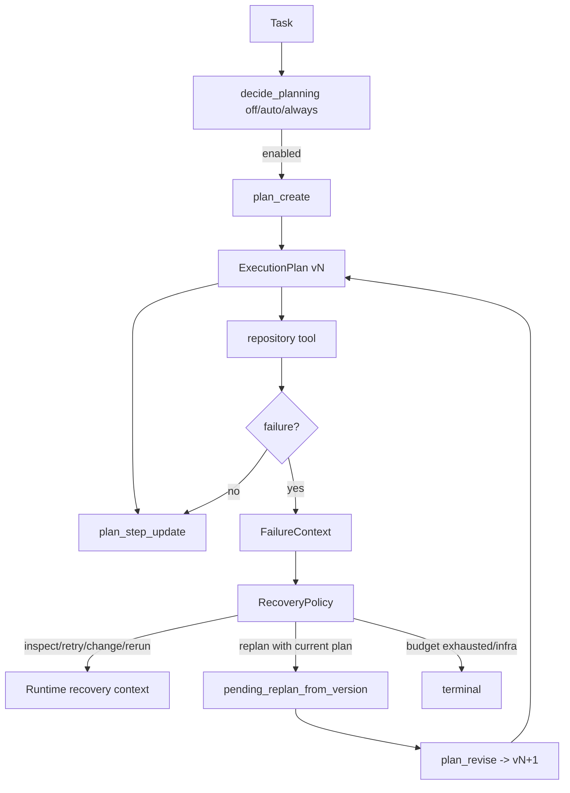

# 04 Structured Planning 与 Failure-aware Recovery

> 基线：`dev@fd700bdf48ace5f03bb9feab49d72f7c12e5ddcb`，2026-11-12

## 1. 功能目标

Planning 把多步意图变成 typed runtime state；Recovery 将可恢复失败分类为有预算的下一策略。两者
都在现有 Agent loop 内工作，避免额外 Planner/Recovery Agent 和第二套 History。

## 2. 职责与边界

Planning 管 goal、step、version、status 和 mutation-before-plan gate，不证明任务完成。Recovery 管
failure category、策略预算和 replan gate，不接管 Provider retry、cancel 或 infrastructure fatal。
普通 prompt 中“先计划”没有结构化状态、动态 schema 或 mutation enforcement，不能与本模块混称。

## 3. 交互图

## 4. 关键执行流程

`off` 不暴露 control schema；`always` 强制；`auto` 在 require_tests、多路径提示或多阶段语言时
启用。无 plan 时只暴露 `plan_create`；有 plan 后只暴露动态 step-id enum 的 update/revise。
Runtime 生成稳定 step id，拒绝 terminal rollback，重复同状态是 idempotent no-op。

Tool/test/loop/no-progress/completion rejection 形成 `FailureContext`。Policy 使用 per-category
`max_attempts`，另有默认三倍的 global ceiling。首次 test/tool failure 通常 INSPECT，重复失败可能
REPLAN/CHANGE_APPROACH；permission deny 不原样重试；completion 缺测试或 final-state unverified
选择 RERUN_TEST。已有 plan 上的 REPLAN 记录旧 version，后续 repository mutation 被阻止，直到
`plan_revise` 产生更新版本。FINISH 仍允许，但必须通过 Completion Guard。

## 5. 核心数据结构

- `PlanningDecision`：mode、enabled、reason。
- `ExecutionPlan`：goal、steps、version、previous_version、revision_reason。
- `PlanStep`：runtime-owned id、description、targets、verification、status。
- `PlanRevision`：版本 lineage。
- `FailureContext`：category/source/evidence、tool/error、plan、repo/test 状态。
- `RecoveryDecision`：strategy、reason、category/global attempt、terminal/revision flags。
- `RecoveryRuntime.pending_replan_from_version`：跨轮 gate 状态。

## 6. 源码对应关系

| 符号 | 职责 |
|---|---|
| `decide_planning` | off/auto/always deterministic gating |
| `planning_control_schemas` | 根据 current plan 暴露动态工具 schema |
| `PlanningRuntime.apply_control` | create/update/revise 验证和 Trace payload |
| `RecoveryPolicy.decide/_choose_strategy` | 分类预算与确定性策略 |
| `RecoveryRuntime.requires_replan` | mutation gate |
| `classify_tool_failure` | ToolResult → FailureCategory |
| `Agent._handle_recovery` | 写 failure/recovery Trace 并注入下一轮提示 |

## 7. 关键实现细节

Plan/Recovery context 每轮作为 bounded system section 注入，不写 canonical History，故 compaction
不会丢失当前状态。Agent 的 active tool schemas 把 control schema 与 Registry schema 一起传给
backend，避免 prompt 与 provider tools 分叉。Plan create/revise 和首次 Skill/Test/MCP evidence
才算 semantic progress；control no-op 仍进入统一 no-progress guard。

## 8. 设计取舍

确定性 runtime 拥有 step identity 和 transition，减少模型伪造状态；代价是多出 control turns 和
token。Recovery 是规则策略而非学习策略，可审计但可能过度触发。Benchmark V1 R2 中 Full P2
24/24 建 plan、0 revision，且成本更高，说明当前 gating/触发仍需优化；不能据此说 Planning/Recovery
没有价值，也不能说它们提升成功率。

## 9. 测试与验证

`tests/test_structured_planning.py` 覆盖模式、schema、transition、compaction 后状态和 gate；
`tests/test_structured_recovery.py` 覆盖分类、预算、replan、completion；`tests/test_failure_harness.py`
锁定 Provider/infra 分离；`tests/test_coding_agent_eval.py` 固定 architecture variants 和 process metrics。

## 10. 面试理解重点

**结构化 Planning 与 prompt planning 的差异？** 前者有 typed state、动态 control schema、runtime
step id、Trace 和 mutation gate；后者只是自然语言建议。
**为什么 Provider retry 不属于 Recovery？** retry 发生在一次模型调用的协议层；Recovery 消费的是
Agent 可观察的任务执行失败。
**为什么 REPLAN 后阻止 mutation？** 防止模型口头说“重规划”却继续执行旧方案；新 plan version 是
解除 gate 的可核查证据。
