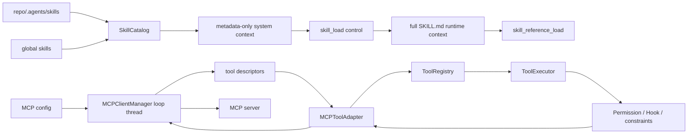

# 05 Agent Skills 与 MCP

> 基线：`dev@fd700bdf48ace5f03bb9feab49d72f7c12e5ddcb`，2026-11-12

## 1. 功能目标

Skills 提供仓库/全局的按需工作流知识；MCP 提供外部 capability。两者都只扩展现有 Agent：
Skill 以 context progressive disclosure 生效，MCP 适配成普通 Forge Tool 生效。

## 2. 职责与边界

Skill subsystem 发现、校验、加载 Markdown 和 reference，但不执行脚本。MCP manager 管连接和
official SDK，adapter 管 schema/effect/result mapping；MCP 不绕过 Registry、ToolExecutor、
Permission、Planning gate、cancel 或 Trace。Candidate Skill 不在普通 Catalog 路径内，除非显式晋升。

## 3. 调用图

## 4. 关键执行流程

Catalog 扫描 project 与 global root，解析 `SKILL.md` frontmatter；同名 project 覆盖 global，坏
Skill 只形成 discovery issue。首轮 system context 只含 name/description/resources manifest；
模型调用 `skill_load` 后完整 instructions 进入每轮 runtime context，reference 需再显式加载。

MCP manager 在专用线程启动 asyncio loop，为每个 server 建 official `Client` context，分页发现
tools，生成 bounded descriptor/snapshot。Adapter 注册为 `mcp__<server>__<tool>`；调用时先走
ToolExecutor，再用 thread-safe future 执行 async `call_tool`。direct/Chat manager 可复用；
isolate 每 run 创建并关闭。

## 5. 核心数据结构

- `SkillDefinition`：name、description、instructions、root/source、resources。
- `SkillDiscoveryIssue`：单项坏 Skill 的隔离错误。
- `SkillRuntime`：loaded skills/references、上限和 control result。
- `MCPToolDescriptor/MCPServerSnapshot`：不含 secret 的 capability 元数据。
- `MCPToolAdapter`：同步 `BaseTool`，持有 effect、schema 和 manager 引用。
- `MCPConfig/MCPServerConfig`：transport、timeout、annotation trust 等可信配置。

## 6. 源码对应关系

| 符号 | 职责 |
|---|---|
| `SkillCatalog.discover` / `_load_skill` | 扫描、frontmatter、override、隔离错误 |
| `SkillRuntime.render_context/apply_control` | progressive disclosure |
| `MCPClientManager.start/_supervisor/call_tool/close` | 连接、发现、同步桥、清理 |
| `namespaced_tool_name/validate_remote_schema` | 名称和不可信 schema 边界 |
| `MCPToolAdapter.effect/execute` | annotation trust、错误映射 |
| `attach_mcp_tools` | manager 启动并注册 adapter |

## 7. 关键实现细节

- Skill path/reference 解析受 root 边界限制，单个资源按字符上限加载；manifest 不等于执行权限。
- 已加载 Skill/Reference 每轮重注入，跨 compaction 保持；重复 load 不算 semantic progress。
- remote description/schema/tool count/output 都有上限，防止 capability metadata 无界占用 Context。
- ToolAnnotations 默认不可信；只有 server 配置显式信任且 `read_only_hint=true` 才映射 READ_ONLY，
  否则 MAY_MUTATE 并要求确认。
- timeout → TIMEOUT；remote protocol/server failure → REMOTE_CAPABILITY；manager invariant →
  INFRASTRUCTURE；invalid params 单独映射。
- Trace 记录 server/tool correlation，不记录 URL、env 或 secret。

## 8. 设计取舍

metadata-first 减少常驻 token，但依赖模型主动 load；真实 P2-5 final gate 中 Candidate 被发现却未
select/load，说明 adoption 是当前限制。MCP 用同步 adapter 保持单一 Tool lifecycle，代价是专用
loop thread 和显式清理复杂度。远端 annotation 采用 opt-in trust，牺牲便利换取保守副作用边界。

## 9. 测试与验证

`tests/test_agent_skills.py` 覆盖 discovery、override、progressive disclosure、reference、坏 Skill、
compaction 与脚本不执行；`tests/test_mcp_integration.py` 覆盖 in-process/stdio、multi-server、
schema bounds、crash/timeout、permission、Planning/Recovery、direct reuse/isolate ownership。
真实 MCP r3 是独立单次 E2E，不是稳定性能 A/B。

## 10. 面试理解重点

**为什么 MCP Tool 不直接调用 client？** 适配成 `BaseTool` 后才能统一 validation、Hook、Permission、
cancel、Planning effect 和 Trace。
**progressive disclosure 的核心是什么？** metadata 可发现，完整 instruction/reference 按需进入
runtime context；未 load 就不能把正文当成已执行经验。
**Skill script 为什么不自动运行？** Skill 是知识，不是权限；可执行动作仍必须显式使用 Tool。
