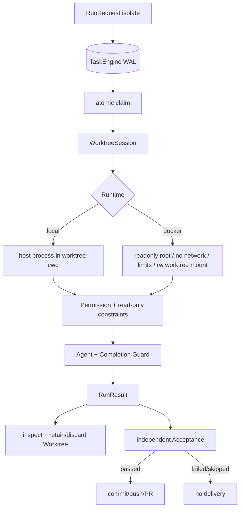

# 06 隔离、可靠性与独立验收

> 基线：`dev@fd700bdf48ace5f03bb9feab49d72f7c12e5ddcb`，2026-11-12

## 1. 功能目标

把并发任务认领、Git 成果隔离、进程沙箱、工具权限、完成性与外部验收拆成可组合层，避免把
“工作区隔离”“安全沙箱”“Agent 自报完成”“可交付 PR”混为同一保证。

## 2. 职责与边界

TaskEngine 管 isolate 任务状态；Worktree 管 Git 工作区；Runtime 管进程；Permission/Constraints 管
ToolCall；Completion Guard 管 Agent 内完成性；Acceptance 管 Runner 外正确性；delivery 管 GitHub
副作用。任何一层通过都不能替代下一层。

## 3. 边界图

## 4. 关键执行流程

TaskEngine 用 SQLite WAL 建 task/dependency，`claim_task` 通过条件 UPDATE 原子认领。WorktreeSession
从 base commit 创建 `wt/<name>`，绑定 Engine；Orchestrator 构造 Local 或 Docker Runtime。
isolate+sandbox 在调用模型前 preflight，确认 git/pytest/worktree 可见且可写。

执行中 workspace-bound Permission 防路径逃逸；可信 `ExecutionConstraints(read_only=True)` 使用
严格白名单，不能被 AllowEverything 或 confirm 放宽。结束后 Worktree inspect staged/unstaged/
untracked/commit；`keep-if-changed` 有成果或无法安全判定时保留，`discard` 清理。

Runner 仅在 Agent SUCCESS 时执行 independent checks；非成功标记 skipped。required/forbidden paths
比较变更，verifier 在模型不可见的 workspace 上运行。GitHub delivery 再执行 commit、push、PR，并
写 delivery Trace；失败保留可恢复成果。

## 5. 核心数据结构

- `task.engine.Task`：status、owner、worktree、依赖。
- `WorktreeChanges/WorktreeArtifact`：变更集合、final disposition、partial。
- `Runtime.RunResult`：子进程 exit/stdout/stderr；不要与 Agent `RunResult` 混淆。
- `ExecutionConstraints`：当前只有可信 `read_only`。
- `PermissionDecision`：ALLOW/DENY/CONFIRM。
- `AcceptanceContract`：change/test、path contract、hidden verifier。

## 6. 源码对应关系

| 符号 | 职责 |
|---|---|
| `TaskEngine.claim_task/complete_task/fail_task` | 并发状态机 |
| `WorktreeSession.create/inspect_changes/finalize` | Git 工作区生命周期 |
| `build_docker_run_args/DockerRuntime.preflight` | 容器边界 |
| `PermissionManager.check/read_only_allows` | shell/path/MCP/只读策略 |
| `Agent.run` FINISH 分支 | Completion Guard |
| `_apply_independent_acceptance` | Agent 后置验收 |
| `deliver_pull_request` | 确定性 GitHub 交付 |

## 7. 关键实现细节

- Docker 默认网络关闭、root readonly、资源限制；但 rw mount 的 worktree 会反映宿主变化。
- Git worktree 的 `.git` 可能是 file，Docker 需要显式挂载 common Git dir。
- read-only shell 只允许固定查询命令；Test/MCP/未知 Shell 即使标记 effect 也不自动视为无副作用。
- Permission deny 是可恢复 Observation；permission subsystem crash 是 fatal infrastructure。
- Worktree finalization 与 Run status 分开记账；失败任务也可能保留 partial artifact。
- automatic PR registry 不向 Agent 开放交付所有权；commit/push/PR 在验收后由确定性代码完成。

## 8. 设计取舍

分层组合使每个保证可测试，但用户必须理解它们不等价。Worktree 比复制仓库轻且保留 Git 语义，
却不是安全边界；Docker 提供更强进程边界但仍非“完全安全”。Acceptance 不回灌 Agent 保持独立，
代价是隐藏验收失败不能自动修复。

## 9. 测试与验证

`tests/test_task_engine.py`、`tests/test_task_engine_concurrency.py`；`tests/test_worktree_session.py`、
`tests/test_orchestrate.py`；`tests/test_sandbox.py`、`tests/test_execution_workspace.py`；
`tests/test_harness.py`、`tests/test_execution_constraints.py`；`tests/test_runner.py`、
`tests/test_github_issue_delivery.py`、`tests/test_failure_harness_isolate.py`。
真实 merged PR 只有一个正式案例，不能计算总体交付成功率。

## 10. 面试理解重点

**Worktree 和 Docker 分别解决什么？** 前者隔离 Git 成果，后者隔离进程/网络/资源/根文件系统。
**为什么只读约束独立于 Permission？** Permission 可由入口定制；可信运行约束必须是不可放宽上界。
**Agent SUCCESS 为什么仍可能不交付？** Runner 的 hidden acceptance 是独立第二层；只有通过才进入
确定性 delivery。
