# 07 Evaluation Harness 与 Trajectory-driven Evolution

> 基线：`dev@fd700bdf48ace5f03bb9feab49d72f7c12e5ddcb`，2026-11-12

## 1. 功能目标

Evaluation 把 task、环境、grader、trial、artifact 和报告固定成可比较协议；Evolution 在运行后从
已验收 Trace 提取候选 Skill，并以独立评测和确定性 Gate 决定是否允许显式晋升。

## 2. 职责与边界

Harness 复用生产 `ExecutionRunner → Agent → ToolExecutor`，不实现第二套 Agent。grader 不进入
prompt。Evolution 不进入当前 run，不训练模型，不自动修改正式 Skills；Trace 是过程事实，
TrialResult/GraderResult 是评测判断。

## 3. 评测与演化链

```mermaid
flowchart LR
  SUITE[EvaluationSuite] --> MAT[materialize clean task repo]
  MAT --> RUN[EvaluationHarness -> ExecutionRunner]
  RUN --> TRACE[Trace v2 + patch + final state]
  TRACE --> GRADE[required/non-required graders]
  GRADE --> TRIAL[TrialResult + process/outcome metrics]
  TRIAL --> REPORT[aggregate report]
  TRACE --> LOAD[load_trajectory]
  TRIAL --> LOAD
  LOAD --> MINE[ExperienceMiner]
  MINE --> GEN[DeterministicCandidateGenerator]
  GEN --> STORE[CandidateStore isolated]
  STORE --> PAIR[baseline/candidate EvaluationHarness]
  PAIR --> GATE[PromotionGate]
  GATE -->|PASS + explicit action| PROMOTE[PromotionManager -> project Skill]
  GATE -->|REJECT/insufficient/error| KEEP[not promoted]
```

## 4. 关键执行流程

Suite 可基于内嵌 files 或冻结 external repository commit。materialization checkout exact commit，
移除原 Git history、应用 setup overlay，再初始化单一 trial baseline，避免答案从历史泄漏。
reference solution 在真实模型前由 deterministic grader 自检。每个 trial 独立目录，输出拒绝覆盖。

Harness 构造 variant-specific AgentConfig/Skills/MCP，调用 Runner，随后运行 command/file/
repository_state/run_trace/test-change/recovery-motif 等 grader，保存 patch/final state/trace refs。
required outcome grader 与 Run/Acceptance 决定 success；process grader 可独立记录。

Evolution 只接受 `RunStatus.SUCCESS + acceptance=passed` 的 positive trajectory。successful workflow
按完整 typed workflow；recovery 使用 `failure category → recovery strategy → first semantic action`
有界 motif，同一 trace 对同一 motif 最多一份 evidence。Candidate 存于
`.forge-agent/experience`，普通 Catalog 看不到。PromotionGate 检查 evidence、outcome、
non-regression、process/trigger、overhead、hash/version；promotion 必须显式调用。

## 5. 核心数据结构

- `EvaluationSuite/EvalTask/RepositorySource/TrialConfig`：冻结协议。
- `GraderSpec/GraderResult/TrialMetrics/TrialResult/EvalReport`：判定与产物。
- `TrajectoryRef/NormalizedTrajectory/ExperiencePattern`：来源与规范化模式。
- `SkillCandidate/EvaluationRecord/PromotionDecision`：候选、配对证据、Gate 结果。
- `CandidateStore`：原子 artifact、status、evaluation、decision、approved snapshot。

## 6. 源码对应关系

| 符号 | 职责 |
|---|---|
| `materialize_task_repo/validate_reference_solution` | 冻结环境与 reference 自检 |
| `EvaluationHarness.run/_run_trial` | trial 编排与生产 Runner 接线 |
| `grade/required_graders_passed/extract_metrics` | outcome/process grader |
| `load_trajectory/ExperienceMiner.mine` | Trace 规范化与 motif grouping |
| `DeterministicCandidateGenerator.generate` | 标准 SKILL.md candidate |
| `evaluate_candidate/build_evaluation_record` | baseline/candidate 对照 |
| `PromotionGate.evaluate` | 四状态确定性决策 |
| `PromotionManager.promote/rollback` | 显式 project Skill 变更 |

## 7. 关键实现细节

- 默认 CLI 不带 real-model flag 只做 validation，并写 `not_executed`，不会构造 Provider。
- output 与 process 分离：required process grader 不重复污染功能 outcome。
- Eval artifact 保存 source/suite/model/budget/Repo Map/MCP identity，report 比较时拒绝 drift。
- Candidate identity/hash 排除本机 artifact path，source evidence 去重；旧 Candidate 不因 renderer
  变化冒充新版本。
- Promotion 区分 PASS、REJECT、INSUFFICIENT_EVIDENCE、EVALUATION_FAILED；基础设施失败不算候选失败。
- manual Skill 无 Forge provenance 时禁止覆盖；managed upgrade/rollback 校验 parent version/hash。

## 8. 设计取舍与真实局限

Benchmark V1 R2：同一冻结 12-task、48 real-model trials，baseline `23/24`，Full P2 `23/24`，
delta 0.0 pp；Full P2 成功 trial mean steps/tokens/time 均更高。它说明当前组合策略未在该 suite
提高 observed acceptance，不代表所有任务或模型。

P2-5：3 条 accepted source traces 产生 recovery motifs，选中一个 Candidate 做 8 个 real-model
final-gate trials；replay 后功能 outcome 成功，但 Candidate 未 select/load，process 不通过，
PromotionGate REJECT，未晋升。这证明 Gate 会拒绝缺乏增量证据的候选，不证明“自动进化”。

## 9. 测试与验证

`tests/test_coding_agent_eval.py`、`tests/test_coding_agent_benchmark_v1.py`、
`tests/test_abstention_scoring_v2.py`、`tests/test_coding_agent_abstention_pilot.py`；
`tests/test_skill_evolution.py`、`tests/test_real_skill_evolution_driver.py`、
`tests/test_real_skill_evolution_eval.py`。真实数字只引用冻结 report/evidence，不重新运行收费评测。

## 10. 面试理解重点

**如何避免 Agent 控制测试结果？** fixture/grader/Acceptance 由 Harness/Runner 持有，不进入 prompt，
并保留独立 artifact。
**为什么 process 与 outcome 分开？** 任务正确不代表候选机制被采用；合并会把 adoption failure
重复算成功能 regression。
**为什么 Evolution 不是在线自学习？** 它是 post-run、离线、deterministic mining + eval gate，
最终 promotion 仍需显式动作。
