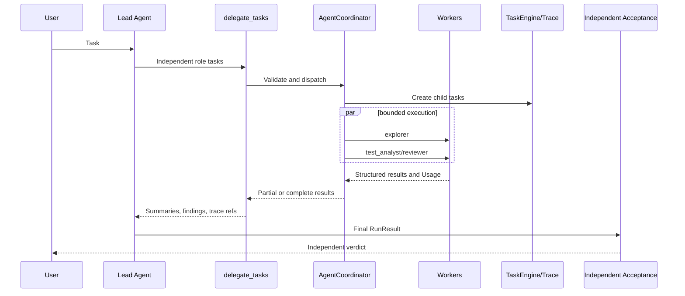

# Supervisor-Worker 协作架构

> 源码核查：2026-11-16，`fix/supervisor-worker-harness-20261116` 阶段 2 工作树。架构映射的历史基线是 `fd700bdf48ace5f03bb9feab49d72f7c12e5ddcb`（2026-11-12）；本文内容以本轮源码为准。只有离线 MockBackend 和本地 Worktree 验证；付费模型表现见后续实验记录。

## 为什么采用此架构

Forge 的 `Agent.run()` 是同步 ReAct，`ExecutionRunner` 负责四入口及独立验收，`TaskEngine` 已提供 SQLite WAL 任务状态。让 Lead 通过一个 `delegate_tasks` 工具提出相互独立的分析，再由 `AgentCoordinator` 用有界线程池并行执行，可以保留这些边界。Worker 共享只读仓库，Lead 是唯一写入者，避免并发 patch 冲突。

## 模块职责与调用协议

| 模块 | 责任 |
|---|---|
| `agent/core.py` | Lead/Worker 共用同步 ReAct；只消费 Tool Result，不管理其他 Agent 生命周期。 |
| `agent/runner.py` | 四入口统一合同、组装 Lead 的 Delegate Tool、汇总 Worker Usage、独立 Acceptance。 |
| `agent/orchestrate.py` | isolate Worktree 内注册 Delegate Tool，保持原 Worktree 生命周期和 TaskEngine 主任务状态。 |
| `agent/coordinator.py` | 校验委派、选择声明式角色、创建独立 Worker Runner、并发/预算/取消/超时/部分结果。 |
| `task/engine.py` | 父任务 ID、Agent ID、角色和 pending/in_progress/completed/failed 状态持久化；direct Runner 记录 Lead 与子任务，isolate 沿用现有主任务记录；不实现 Agent Loop。旧库启动时增量加列。 |
| `harness/permission.py` | safe 只读约束和全局 DENY；Worker 另有角色工具白名单，二者叠加。 |

`delegate_tasks` 输入为 `tasks: [{role, task}, ...]`；输出包括 task_id、agent_id、role、status、summary、findings、recommendations、token_usage、elapsed_time、trace_reference、parent_task_id、usage_complete。Worker Prompt 请求 JSON；如果模型返回普通文字，summary 保留原文，findings/recommendations 为空，不伪造文件行号。

工具参数的 `role.enum` 和执行校验来自同一 `PROFILES` 列表。未知角色在创建子任务前拒绝并返回合法值；自定义分析方向写进 `task`，不增加隐式角色或放宽 Worker 权限。

## 配置、上下文和权限

`agent.multi_agent_enabled` 默认为 false，CLI `--multi-agent` 只提供委派工具，由 Lead 决定是否调用；任务文本也可能明确要求调用。三个角色是 explorer、test_analyst、reviewer，各有 Prompt、工具白名单、步数和 Token 上限；默认继承 Lead 模型，`agent.worker_models` 可按角色覆盖。每个 Worker 新建 Backend、Registry、Executor、History、RepoMap cache、EventLog 与取消视图；只共享仓库文件和只读配置值。默认最多 3 个并行 Worker、每次最多 3 项、每项最多 12 步/24K Token，整次运行 Worker 总预算 72K，单次委派超时 120 秒；配置可覆盖总量和并发，角色上限仍固定。

Worker 注册的查询工具由角色白名单选择；没有 file_write、shell、test、MCP 或 `delegate_tasks`。Runner 再强制 safe/read_only，工作区路径经 PermissionManager 检查。全局限制优先于角色工具。LocalRuntime 的进程环境过滤不等于 OS 隔离；当 Lead 选用 sandboxed Profile 时，每个 Worker 另建只读根文件系统、只读仓库挂载和断网的 DockerRuntime，并在 Provider 调用前做 preflight。文件/搜索工具仍由宿主只读实现且受 workspace 边界限制；不能把 Docker 路径称为全部宿主代码隔离。

Worker 的结构化 Planning 固定为 off：只读分析可以直接返回发现，不继承 Lead 的强制 Plan 门槛。Lead 的 Plan 仍由自身配置决定。

Lead 的工具 Trace 包含 Worker 结构化结果和子 Trace 路径；子 Trace 的 Task 带 parent_task_id/agent_id/role。Runner 的 `worker_usage` 单独保存，并并入整次 `usage`。超时或异常中无法核实未返回的 Provider Usage 时，`usage_complete=false`；不把未知成本当作 0。超时/取消通过 Event 在调用边界传播，已发出的同步 Provider 请求不能强制终止，Coordinator 关闭后不接受新的委派。

`workers_summary` 另记录 Worker 总数、非成功数和子 Trace 中的工具调用数；Evaluation Harness 的总工具调用数包含这些子调用。A/B 使用显式 `--total-token-budget` 给两变体设同一上限，Supervisor 预留其中 1/3 给 Worker。模型调用后才有 Provider Usage，因此上限可能被一次已发出的调用越过；API 货币成本不能由 Token 数直接推算。

Runner 的 Independent Acceptance 始终在 Lead 运行后执行；Worker 分析成功不会替代验收，Lead FINISH 也不会抹去 Worker 失败或未知 Usage。

## 外部实现的取舍

- [OpenHands SDK](https://github.com/OpenHands/software-agent-sdk)：采用“任务管理与独立子 Agent 上下文分离”的方向；没有复制其 TaskManager/Scope 对象图，Forge 复用 TaskEngine 和 Runner。
- [Codex multi-agent handlers](https://github.com/openai/codex/tree/main/codex-rs/core/src/tools/handlers/multi_agents_v2)：采用显式委派、父子关系、等待与取消语义；Forge 保留同步 ReAct，用线程池在外层协调，没有复制 Thread 实现。
- [OpenCode agents](https://opencode.ai/docs/agents/)：采用声明式角色 Prompt、工具和权限；Forge 在代码中冻结首版三个角色，避免额外配置文件解析与权限漂移。
- [Aider Repo Map](https://aider.chat/docs/repomap.html)：借鉴小预算结构摘要；Forge 保留自身增量索引与现有排序，未在没有质量证据前改用 PageRank。
- [Claude Code Agent Teams](https://code.claude.com/docs/en/agent-teams)：把 Peer-to-Peer、共享任务沟通和多个写入者视作另一种协作模式；本轮只实现 Lead/Worker 结果返回。

## 验证与边界

Project Memory 增量：Lead 可使用 `memory_search`、`memory_read` 和仅写 pending 的 `memory_propose`；Worker 的独立 Registry 仅注册前两个工具，`memory_candidates` 只作为结构化建议返回 Lead，Worker 不写正式记忆。各 Worker 从相同项目 ID 读取自己的检索结果，Runner 在独立验收后统一记录活动并处理 Lead 候选。详见 [10-Project-Memory-架构](10-Project-Memory-架构.md)。

`tests/test_agent_coordinator.py` 覆盖两个 Worker 真实线程并发、独立 Backend/Trace、角色只读、部分失败、父级取消、超时、预算、旧库迁移、direct/isolate 集成与 Independent Acceptance。MockBackend 只能证明控制流和权限；Docker 动态路径未在无 Docker 的环境中验收，也不能证明真实 Provider 成功率。正式四类 A/B 的冻结任务与验收合同尚待补齐；货币成本需要模型价格输入，本轮仅汇总可核实的 Token 与调用次数。
