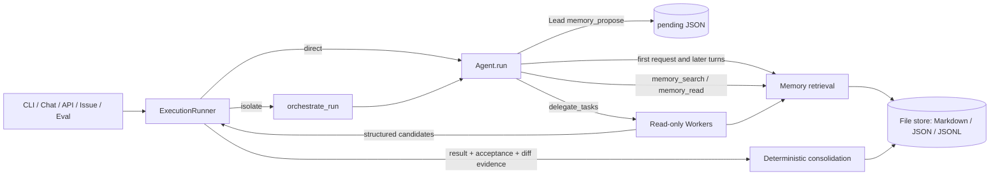

# Project Memory 架构

> 实施合同：2026-11-18，基于 `dev@2d86954` 与当前未提交工作树核查。架构映射的继承基线为 `fd700bdf48ace5f03bb9feab49d72f7c12e5ddcb`（2026-11-12）；本文以实际源码和本轮测试为准。

## 边界

每个项目使用一个本地文件目录 `~/.forge-agent/projects/<project_id>`；RepoMap、TaskEngine、Chat Session 和 Trace 保持原有存储。`ProjectIdentityResolver` 优先把 Git origin 规范化后哈希；没有 origin 使用 Git common dir；非 Git 使用绝对路径。同一 remote 的 clone 和 worktree 共享 ID。identity.json 只保存脱敏后的规范身份。

`MEMORY.md` 是索引；正式 Markdown 用 YAML front matter 记录 ID、类型、状态、可信度、来源 run/commit/file/hash 与验证时间。候选 JSON 只在 pending；activity.jsonl 只记摘要、结果、路径、验收和 Trace 引用。统一 Writer 在跨进程锁内以临时文件、fsync 和 replace 更新，校验目录边界并脱敏。损坏单条记录不能破坏旧内容。

检索按路径、符号、标题/标签、词频、可信度和验证时间排序；`needs_revalidation` 带风险提示，`superseded`/`archived` 不注入。用当前 `TokenBudget.counter` 限制记忆段，最终段落进入同一个 system prompt 压力计算；不写入 canonical History。记忆是低可信历史资料，引用前核查当前源码，不能覆盖权限或当前任务。

Lead 可检索、读取和提出 pending 候选；Worker 只读并可在结构化结果中建议候选，Lead 统一处理。任务结束后，仅有成功状态和独立验收通过，或 Trace 中的成功 `test`/`pytest` 发生在最后一次仓库内容修改之后的 feature/experience 可自动标记 verified；decision/constraint/architecture 默认 proposed；失败、取消和未合入的 isolate 不自动升级。源码文件 hash 改变只使相关记忆过期，不因 HEAD 整体变化而过期。写入错误只记录诊断，不改变 RunResult。

评测默认关闭记忆；仅显式启用 `memory.evaluation_enabled` 时参与。真实模型效果与 MockBackend 控制流测试分开报告。

Harbor 的 Core-20 B 配置另用 `memory.defer_promotion`，禁止 Forge 自测触发本地晋升或留下可跨 trial 检索的活动日志。可信宿主仅从发布 store 导出已验证、活跃的记录；适配器可在新 trial 启动前导入与仓库 ID 匹配的 JSON 包。候选、活动日志和工作树不随包传输；导入会验证字段、源文件哈希格式和空 store，再重建索引。独立 verifier 后的快照取证与自动发布仍需端到端接线验证。

## 配置和操作

`config.schema.MemoryConfig` 解析 `enabled/root/auto_capture/context_budget_tokens/max_results/evaluation_enabled`；`entry.context_common.configured_agent_options` 给 CLI、Chat、API、Issue 和 Eval 使用同一配置。`root` 必须是绝对路径。`forgeAgent memory status/show/search/approve/reject --repo PATH` 管理本地文件；CLI approve 才能给予 `user_confirmed`。配置示例和完整命令见仓库根目录 `USAGE.md`。

Trace v2 增加 retrieval、candidate、consolidation 事件；检索与收口各用对应 span，记录 ID、数量、Token 和耗时。`memory_propose` 的参数与原始模型文本在 Trace 写入前遮蔽，Activity 不保存完整 Diff、工具输出或对话。文件锁同时支持 Linux `fcntl` 和 Windows `msvcrt`，正式写入走临时文件、fsync 与 replace；Worker 不接触 Writer。
