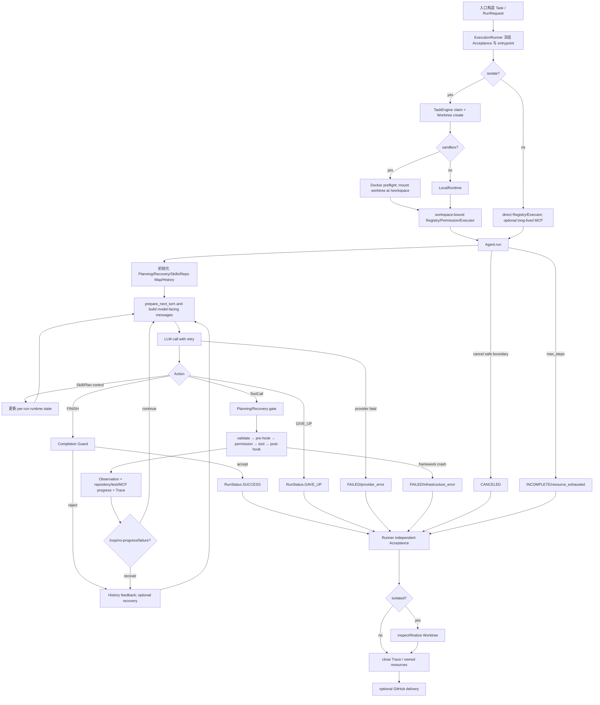

# Forge Agent 当前代码架构

> 审查基线：`dev@fd700bdf48ace5f03bb9feab49d72f7c12e5ddcb`
> 验证日期：2026-11-12
> 工作树基线：审查开始时 clean；保留既有 `stash@{0}`，未读取、未应用。
> 事实规则：当前源码是实现事实；测试说明已固定的行为；历史文档只说明决策和实验；计划不算已实现。

## 1. 系统定位与阅读入口

Forge Agent 是以同步 `agent.core.Agent.run()` 为内核的编码 Agent。四个产品入口共享
`agent.runner.ExecutionRunner`，但只有 `isolate=True` 的请求进入异步
`agent.orchestrate.orchestrate_run()`；direct、Chat 和 GitHub direct 路径由 Runner 直接调用
`Agent.run()`。这个差异是理解对象所有权、Worktree 和清理行为的第一条主线。

建议按以下顺序阅读：

1. 本文：先建立五条执行路径和状态边界；
2. [01-任务执行主链](01-任务执行主链.md)：入口、Runner、Orchestrator；
3. [02-Agent与Tool生命周期](02-Agent与Tool生命周期.md)：同步主循环、Tool lifecycle、终止；
4. [03-Context与RepoMap](03-Context与RepoMap.md)：上下文、索引、压缩和 Session；
5. [04-Planning与Recovery](04-Planning与Recovery.md)、[05-Skills与MCP](05-Skills与MCP.md)；
6. [06-隔离与独立验收](06-隔离与独立验收.md)、[07-Evaluation与Evolution](07-Evaluation与Evolution.md)；
7. [源码索引](源码索引.md)：从功能定位到符号和测试。

## 2. System Architecture

<!-- --8<-- [start:system-architecture] -->
--8<-- "docs/includes/system-architecture.md.inc"
<!-- --8<-- [end:system-architecture] -->

图中的实线是当前调用或数据流；Candidate 到正式 Skill 的虚线表示只有显式、校验通过的
promotion 才会发生。本项目没有自动 promotion，也没有第二套 Agent 主循环。

## 3. 五条生命周期不能混成一条

| 路径 | 汇合点 | 特有状态/分叉 | 不应误解为 |
|---|---|---|---|
| Production Runtime | 四入口 → `ExecutionRunner` → `Agent.run` | direct 可组合 Docker；isolate 才进入 Orchestrator/Worktree | 所有请求都经过 Worktree |
| Chat Session | `ChatSession.run_round` → Runner direct | 共享 canonical History、`state.json`、每轮 Trace、Chat 专用 compaction callback | EventLog 可恢复 Session |
| GitHub Delivery | Issue → Runner direct → Acceptance → delivery | Agent registry 移除自动 PR 所有权外的 Git 提交工具；交付层 commit/push/PR | Agent 自己发布 PR |
| Evaluation | `EvaluationHarness._run_trial` → Runner | 冻结 fixture、grader、artifact、process/outcome metrics | 另一个 Agent runtime |
| Post-run Evolution | Trace/TrialResult → mining → Candidate → gate | 离线处理；Candidate 与正式 `.agents/skills` 隔离 | 在线自我训练或自动生效 |

## 4. Task Execution Lifecycle

Completion Guard 在 Agent 内；Independent Acceptance 在 Agent 返回后，由 Runner 持有，隐藏
verifier 不进入 History。Acceptance 失败不会反写主循环继续修复。

## 5. 核心状态与所有者

| 状态 | 所有者 | 生命周期/持久化 |
|---|---|---|
| `Task`、`RunResult` | `agent.task` / Runner | 单次 run；Result 汇总状态、usage、Trace、Worktree、Acceptance |
| canonical `ConversationHistory` | Agent/ChatSession | direct 单 run；Chat 跨轮并写入 Session `state.json` |
| model-facing compacted view | `TraceableCompaction` + Agent | 下一请求的一次性 override，不覆盖 canonical History |
| Planning/Recovery/Skill runtime | Agent | 每个 run 重建；每轮注入 system context，不依赖 History 保存 |
| Repo Map 结构索引 | `PersistentRepoIndex` | SQLite 持久化；query 只 rerank，可靠 changed path 增量刷新 |
| TaskEngine task state | `TaskEngine` | isolate 路径的 SQLite WAL 状态机 |
| API task state | `ApiTaskStore` | HTTP 队列/取消/结果；与 TaskEngine 是不同状态域 |
| Chat Session state | `JsonChatSessionStore` | 原子 JSON、revision 冲突检测、per-round logs |
| Trace v2 | `EventLog` | append-only JSONL 审计；不是执行重放或 Session 数据库 |
| Worktree artifact | WorktreeSession/Orchestrator | inspect 后保留或清理；保留不等于 commit/push/PR |
| Candidate/Evaluation/Decision | `CandidateStore` | 离线 artifact；正式 Skill 需显式 promotion |

## 6. 安全、隔离和完成性的正交边界

- Permission/ExecutionConstraints 决定 ToolCall 是否允许进入副作用执行；可信只读约束不能被
  自定义 permission 或确认回调放宽。
- Worktree 隔离 checkout、index、branch 和成果处置，不隔离进程、网络或宿主系统。
- DockerRuntime 约束进程、网络、资源和根文件系统；挂载的仓库/Worktree 仍可写。
- Completion Guard 验证 Agent 自己的 change/test/final-state 条件。
- Independent Acceptance 在 Agent 外验证 required/forbidden paths 和隐藏 verifier。
- GitHub delivery 只有在 Acceptance 通过后才进入确定性 commit/push/PR。

## 7. 同步与异步边界

`Agent.run()`、Tool API 和 MCP adapter 对 Agent 都是同步接口。异步主要用于
`orchestrate_run()` 的 Worktree/AgentBus 生命周期、MCP manager 的专用 loop thread、FastAPI/SSE
入口和 EventLog→AgentBus 转发。因此 cooperative cancel 只能在 Provider、Tool lifecycle 和 step
安全边界生效，不能强杀任意正在执行的同步调用。

## 8. 当前实现范围与未实现项

已实现：四入口统一 Runner、同步 ReAct、三种 LLM backend、persistent query-aware Repo Map、
Chat Session/Compaction、structured Planning/Recovery、Skills、MCP Tool integration、Tool lifecycle、
Worktree/Docker、Trace v2、Independent Acceptance、Evaluation Harness 和离线 Evolution pipeline。

未实现或不应夸大：多 Agent、parallel/multi-tool call、任意同步调用强制终止、自动 merge、
无人监督发布、分布式 Session、完整 OpenTelemetry、Context recall C6、在线 RL/参数训练、自动
Candidate promotion。Benchmark 结果只适用于冻结协议。

## 9. 对旧架构文档的修正

本文件替换 2026-09-15 版本，主要修正：

1. Runner 不是无条件调用 Orchestrator；只有 isolate 分支进入 `orchestrate_run()`。
2. Repo Map 默认已是 `PersistentRepoMap` + SQLite 结构索引。
3. Context Compaction 当前产品接线集中在 Chat；不是四入口默认启用。
4. Planning/Recovery/Skills 是单一 Agent loop 内的 per-run state；MCP 是普通 Tool adapter；
   Evaluation 和 Evolution 在主循环外。
5. 增加可信 `ExecutionConstraints.read_only`、repository effect 和最新 Completion Guard 日志排除。
6. API Store、TaskEngine、Chat Session 与 Trace 是四种不同状态域。

## 10. 验证与证据边界

主要回归入口见 [源码索引](源码索引.md)。测试通过不等于线上可靠性，单样本也不等于总体性能。
Benchmark V1 R2 的两个变体均为 `23/24`，Full P2 没有提高该 suite 的 observed acceptance，
且执行成本更高；P2-5 Candidate 最终被 Gate 拒绝、未 promotion。详见
[07-Evaluation与Evolution](07-Evaluation与Evolution.md)。

## 11. 后续阶段复用协议

阶段二应直接把本目录 Markdown 作为唯一内容源：导航使用数字前缀，Mermaid 原样渲染，源码
索引表用于搜索与交叉链接；不要复制成另一套 HTML 文案。

阶段三建议：代码 Diff 若改变公共数据结构、对象所有权、调用方向、状态持久化、权限/副作用或
终止语义，则更新对应专题和源码索引；只有跨专题关系变化时才更新总图。局部 bug 修复记录变更
日志即可。每次更新记录 commit、日期，并检查相对链接、源码路径、符号和 Mermaid fence。
