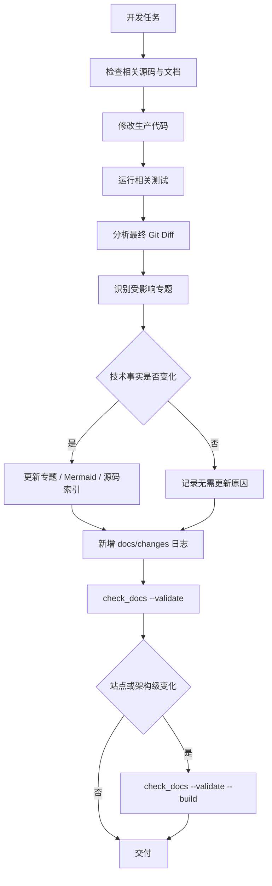

# 架构知识库持续维护协议

> 规则版本：1；核查基线：`dev@fd700bdf48ace5f03bb9feab49d72f7c12e5ddcb`，2026-11-12。

本协议把“修改代码 → 识别架构影响 → 同步知识库 → 验证文档 → 更新本地网站”接入日常开发。
源码仍是实现事实，自动化只做确定性提示和一致性检查，不自动解释或重写架构。

## 1. 文档职责

| 位置 | 职责 | 维护限制 |
|---|---|---|
| `docs/design/` | 经源码核查的当前架构、流程、数据结构与源码索引 | 技术事实变化时更新；不能从历史日志反推当前实现 |
| `docs/changes/` | 每轮开发过程、决策和验证结果 | 仅本地保存；新增日志，不静默重写历史 |
| `docs/evidence/`、`evals/results/` | 测试、Benchmark、A/B 和真实运行证据 | docs evidence 仅本地保存；不因文档维护重新跑收费实验或改写冻结结果 |
| `README.md`、`USAGE.md` | 项目介绍和使用入口 | 不被知识库替代 |
| Zensical `site/` | Markdown 的本地静态展示产物 | 不入 Git，不单独维护 HTML 正文 |

## 2. 开发前与开发后

开发前先列出计划修改的生产文件，运行影响分析，检查它们对应的专题、公共接口、调用协议、状态
转换、安全边界和测试依据。开发后必须以最终 Git Diff 再分析一次；只有技术事实确实改变时，才更新
专题、Mermaid、源码索引和总架构。

必须更新架构文档的典型变化：

- 新增或移除核心组件，改变模块职责、公共接口或调用协议；
- 改变重要执行流程、状态模型、错误分类、恢复策略、权限或安全边界；
- 改变 Context、Planning、Recovery、Skills/MCP、Isolation、Evaluation 等关键机制；
- 新增长期存在的能力，或发现当前文档与源码不一致。

通常可以不改架构专题：纯格式化、注释、只改测试、无契约变化的内部 Bug 修复、站点排版修复。
仍需写本轮 `docs/changes/` 日志，并在交付说明中给出“不更新架构”的原因。

## 3. 机器可读映射

[`architecture-map.json`](architecture-map.json) 保存：

- 模块名称、生产源码路径模式和主专题；
- 相关总览、源码索引和可能的跨模块影响；
- 用 AST 确定性核查的核心类、函数和方法；
- 关键 Mermaid 页面、全文搜索词和阶段一核查版本。

映射允许同一文件命中多个模块。例如 `agent/core.py` 同时提示 Tool lifecycle、Context、
Planning/Recovery 和 Skills/MCP。新增 Python 文件若位于生产源码根、又没有任何映射，会报告
`UNMAPPED SOURCE FILE`；Codex 应先判断归属，不能仅凭文件名自动写架构说明。

## 4. 影响分析语义

```bash
python scripts/check_docs.py
python scripts/check_docs.py --base HEAD~1
python scripts/check_docs.py --changed agent/core.py
```

- 无 `--base` 时，默认比较 `HEAD` 与当前工作树。
- `--base A` 使用明确的两点语义 `A..HEAD`，再合并 staged、unstaged 和未跟踪文件。
- 脚本只读取 Git；不执行 reset、clean、checkout、stash 或写入。
- 为避免大工作树 rename 相似度扫描，Git rename 按 delete/add 两个路径处理；两侧都会参与映射，
  delete 仍按被删除路径提示专题。

状态含义：

| 状态 | 含义 |
|---|---|
| `NO_IMPACT` | 没有发现映射范围内的生产源码变化；不等于所有文档永久正确 |
| `REVIEW_REQUIRED` | 相关源码变化，需要结合真实 Diff 判断技术事实是否改变 |
| `DOCS_UPDATED` | 受影响主专题和源码索引都出现在 Diff 中；不证明内容语义正确 |
| `UNMAPPED` | 生产 Python 文件没有映射，需要人工判断归属 |
| `INVALID_REFERENCE` | 链接、源码路径、符号、Mermaid、构建或离线产物检查失败 |

## 5. 一致性与网站检查

```bash
python scripts/check_docs.py --validate
python scripts/check_docs.py --validate --build
```

`--validate` 使用 Python 标准库检查当前知识库的相对链接、受限格式源码引用、映射中的 AST 符号、
Mermaid 数量、Snippet 和核查版本信息。`--build` 进一步调用隔离的 Zensical 环境执行严格构建，并
检查关键页面、实际搜索索引结果、Mermaid HTML 节点、离线 worker、本地静态资源及历史目录排除。

自动检查不能保证：调用关系解释正确、设计取舍合理、运行时动态注入符号存在、真实浏览器中图表
绝不重叠，或 `file://` 下所有浏览器策略一致。涉及这些语义时仍需 Codex 阅读源码；页面视觉或
浏览器策略变化时需要人工浏览器验收。

## 6. 分级验证

- **L1：测试或局部实现修复**——影响分析 + 相关代码测试；无架构事实变化时记录原因。
- **L2：生产契约或专题变化**——L1 + 更新专题/索引 + `--validate`。
- **L3：架构图、导航、站点或维护系统变化**——L2 + `--validate --build`，必要时本地预览。

不要强制每个小修复都构建完整网站。最终回复只需说明架构影响、更新文档/图表/索引、检查结果和
剩余人工验证边界。

## 7. 标准闭环



核查版本只在实际阅读或更新对应专题后修改；工作树存在未提交实现时，应同时说明基准 HEAD 和
未提交状态，不能把 HEAD 写成已经包含本地改动的版本。
