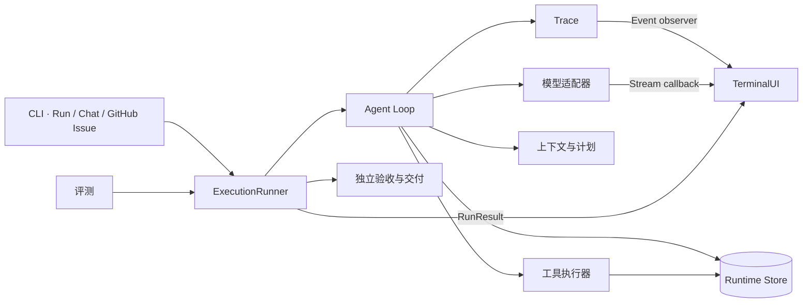

# 整体架构

## 为什么实现

Forge Agent 将 CLI 任务和评测任务组织为可观察、可验收、可续接的执行过程。共用的执行层连接模型决策、仓库交互和完成判断。

## 怎么使用

CLI 的 `run` 适合单次任务，`chat` 保留会话上下文，`runtime` 管理检查点与续接。GitHub Issue 通过命令行完成验收和 PR 交付。评测入口使用同一执行链运行编码任务或注入故障。

## 怎样实现

`entry/` 接收请求，`agent/` 组织执行，`context/` 组装模型上下文，`llm/` 统一协议和用量。`harness/` 管工具执行，`tools/` 提供具体能力。`runtime/` 管 Git 工作树，`task/` 管任务认领，`ipc/` 分发事件。`durable_runtime/` 保存可恢复状态。评测和经验迭代分别在 `evals/` 与 `experience/`。

终端如何协调流式回答、权限确认和最终结果见 [CLI 终端界面](terminal-ui.md)。

## 预期效果

入口共享相同的执行语义，开发者可以从结果查回模型、工具与验收证据。

## 使用边界

检查点是执行状态，Trace 是审计记录，模型的完成声明和独立验收结果分别记录。
